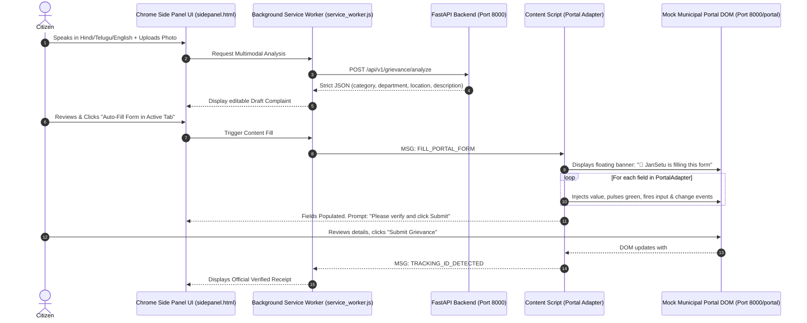

# 🏛️ Nagarik AI (नागरिक AI) — Empowering Every Citizen
### Multimodal Civic Redressal & Browser Form-Filling Copilot

<p align="center">
  
</p>

[](https://github.com/cyugandharreddy08/nxtwave-buildathon-2026)
[](https://developer.chrome.com/docs/extensions/reference/manifest)
[](https://fastapi.tiangolo.com/)
[](https://apisetu.gov.in)
[-brightgreen.svg)](#running-the-test-suite)

> **Nagarik AI** is an autonomous, multimodal civic copilot engineered as a **Chrome (Manifest V3) Extension with a Native Side Panel**. A citizen speaks in their mother tongue (Hindi, Telugu, or English) or uploads a photo. The extension converts this into a structured petition, displays it in the side panel for explicit citizen confirmation, injects an in-page content script that auto-fills the portal form with progressive field highlights, and leaves the final submission to the citizen. If a complaint exceeds the statutory SLA, Nagarik AI drafts formal Reminders, First Appeals (RPSA), and Section 6(1) RTI applications.

---

## 📌 1. Core Features & What Makes This Approach Win
1. **Chrome Side Panel (`chrome.sidePanel`)**: The entire citizen journey—multimodal voice intake, photo upload, draft editing, scheme discovery, and escalation drafting—runs directly in Chrome's native side panel next to the municipal portal.
2. **In-Page Form Auto-Filler via Portal Adapters**:
   - `MockPortalAdapter`: Injects into `http://localhost:8000/portal*`.
   - `CPGRAMSAdapter`: Ready for `https://pgportal.gov.in/*`.
   - Displays a floating banner: *"🤖 JanSetu is filling this form..."*, pulses green on each field, and dispatches synthetic `input` and `change` events so modern JS framework forms register the state.
   - Sets photo file inputs via the modern browser `DataTransfer` API.
3. **Safety & Real-World Feasibility**:
   - **Never auto-submits on real portals**; the citizen solves CAPTCHA/OTP and presses submit.
   - **Zero API Key Leaks**: All AI API keys and Scheme Providers remain strictly on the FastAPI backend; the extension requests minimal permissions (`sidePanel`, `activeTab`, `storage`).
4. **Guided Handoff**: If an unsupported portal or changed DOM layout is encountered, the extension gracefully switches to a Guided Handoff screen with one-click copy buttons for every field.
5. **Official API Setu & Hand-Verified Schemes**:
   - Pluggable `SchemeProvider` supporting live **API Setu (`apisetu.gov.in/v1/myscheme`)** with local cache and **15 hand-verified government schemes** with verbatim `source_text`, `official_url`, and `last_verified_date: "2026-10-30"`.
   - **3-Outcome Scheme Claim Verifier**: Strictly evaluates claims as `Matches official source`, `Contradicts official source`, or `Couldn't verify`.

---

## 🏗️ 2. System Architecture



---

## 🚀 3. Quick Start (Running in 3 Steps)

### Step 1: Start the Backend & Mock Portal
```powershell
# In PowerShell from d:\buildathon:
$env:PYTHONPATH="backend"
.\backend\venv\Scripts\uvicorn.exe app.main:app --host 0.0.0.0 --port 8000 --reload
```
- **Backend API Docs**: [http://localhost:8000/docs](http://localhost:8000/docs)
- **Mock Municipal Portal**: [http://localhost:8000/portal](http://localhost:8000/portal)
- **Operator Status Dashboard**: [http://localhost:8000/portal/admin](http://localhost:8000/portal/admin)

### Step 2: Load the Extension in Google Chrome
1. Open Google Chrome and navigate to `chrome://extensions/`.
2. Toggle on **"Developer mode"** in the top-right corner.
3. Click the **"Load unpacked"** button in the top-left corner.
4. Select the `d:\buildathon\extension` folder.
5. Click on the extension puzzle icon in Chrome and click **JanSetu Lite** to open the **Side Panel**!

### Step 3: Test the Live Citizen Flow
1. Open [http://localhost:8000/portal](http://localhost:8000/portal) in a Chrome tab.
2. In the JanSetu Side Panel, click one of the quick test chips (e.g. *🚧 Road Pothole*).
3. Click **"Synthesize Complaint"** — the AI classifies the municipal department, statutory act, and urgency.
4. Click **"🤖 Auto-Fill Form in Active Tab"** — watch JanSetu display the in-page banner and populate every field live on the page!
5. On the portal page, click **"Submit Grievance"** — the extension immediately detects the generated tracking ID (`CP-2026-XXXXX`) and shows the official receipt in your side panel.
6. In Tab 3 of the side panel, test generating a **First Appeal** or **Section 6(1) RTI Application** for any overdue complaint.

---

## 🧪 4. Running the Test Suite
```powershell
$env:PYTHONPATH="backend"
.\backend\venv\Scripts\pytest backend\tests -v
```
**Results: 14 Passed (100% test pass rate in <1s)**
- `test_root` & `test_health`: Gateway and DB connectivity
- `test_mock_portal_routes`: Mock portal and operator admin console
- `test_mock_portal_selectors_intact`: Contract test verifying extension DOM selectors
- `test_operator_status_toggle`: Verifies operator can toggle complaints to Overdue
- `test_schemes_and_eligibility`: Criteria matcher for welfare schemes
- `test_fact_check_outcomes`: 3-outcome claim verification (`matches`, `contradicts`, `unverified`)
- `test_aadhaar_detection_and_masking`: 12-digit Aadhaar regex protection
- `test_statutory_escalation_draft`: Formal Reminder, Appeal, and RTI generator
- `test_local_scheme_provider` & `test_apisetu_provider_fallback`: SchemeProvider test suite

---

## 👥 Team
- **[@cyugandharreddy08](https://github.com/cyugandharreddy08)** — System Architecture, Backend APIs & Scheme Providers
- **[@baliharsha999](https://github.com/baliharsha999)** — Chrome Extension Manifest V3, Side Panel UX & Content Scripts
- **[@Raghavendra-Kasireddy](https://github.com/Raghavendra-Kasireddy)** — Portal Adapters, Data Pipeline & Test Automation

---

## 📜 License
Built for the **NxtWave Buildathon 2026** under the MIT License.
