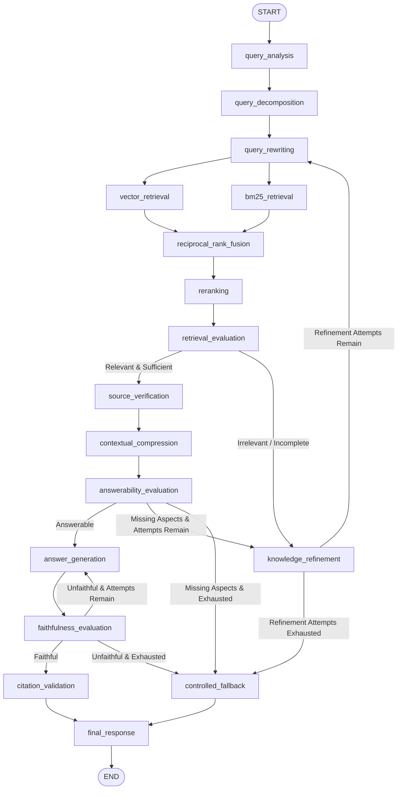

# 🏛️ Advanced Government Information RAG System Using LangGraph

A modular, production-oriented RAG application that retrieves accurate, verified information from official government websites, documents, and database-stored HTML files using **LangGraph**, **Pydantic State**, **FAISS HNSW**, **BM25**, **Reciprocal Rank Fusion (RRF)**, **Cross-Encoder Reranking**, and **Multi-Stage LLM Evaluation Loops**.

---

## 🚀 Key Upgrades & New Architecture

The pipeline upgrades sequential RAG into an intelligent, self-correcting agent graph orchestrated by LangGraph:



---

## 🌟 Intelligent Nodes & Responsibilities

| # | Node Name | Category | Primary Responsibility |
|---|-----------|----------|------------------------|
| 1 | `query_analysis` | Query Understanding | Analyzes user intention, primary topic, target government departments, and temporal freshness needs. |
| 2 | `query_decomposition` | Query Understanding | Breaks compound queries into focused, searchable subqueries covering distinct requirements (eligibility, benefits, procedure). |
| 3 | `query_rewriting` | Retrieval Prep | Generates 5 distinct search query types: **Semantic**, **Keyword-dense**, **Alternative**, **Department-scoped**, and **Gap-targeted**. |
| 4 | `vector_retrieval` | Dense Retrieval | Executes approximate nearest-neighbor vector similarity search on `faiss.IndexHNSWFlat` (Cosine Inner Product). |
| 5 | `bm25_retrieval` | Sparse Retrieval | Keyword-matching search over official terminology, exact scheme names, and acronyms using `BM25Okapi`. |
| 6 | `reciprocal_rank_fusion` | Ranking Fusion | Merges dense and sparse lists using $RRF(d) = \sum \frac{1}{k + rank(d)}$, deduplicating chunks and preserving metadata. |
| 7 | `reranking` | Deep Re-scoring | Cross-Encoder (`ms-marco-MiniLM-L-6-v2`) re-ranks top 20 fused candidates down to top 5 high-relevance chunks. |
| 8 | `retrieval_evaluation` | Quality Gate | LLM assessment of context relevance and topic coverage against configurable relevance threshold (0.75). |
| 9 | `source_verification` | Provenance Audit | Validates `.gov.in`/`.nic.in` domains, checks issuing authority, and computes document age to qualify outdated policies. |
| 10 | `contextual_compression` | Distillation | Extracts concise factual paragraphs; strictly protects monetary figures (`₹`, `Lakh`), dates, percentages, and eligibility rules. |
| 11 | `answerability_evaluation` | Completeness Gate | Verifies whether the compressed context contains sufficient facts to answer the question (distinct from topical relevance). |
| 12 | `knowledge_refinement` | Iterative Loop | Identifies answered vs. missing aspects, crafts targeted gap-filling queries, and loops back to retrieval (max 2 attempts). |
| 13 | `answer_generation` | Generation | Synthesizes authoritative response strictly grounded in verified context; incorporates evaluator feedback during regeneration. |
| 14 | `faithfulness_evaluation` | Hallucination Gate | Verifies all factual numbers, dates, and claims; detects hallucinations and triggers targeted regeneration if ungrounded. |
| 15 | `citation_validation` | Provenance Audit | Validates every cited URL against database records and retrieved chunks; attaches `last_verified_date` metadata. |
| 16 | `controlled_fallback` | Safety Refusal | Returns standardized refusal when retrieval fails or context is unverified: *"I don't have sufficient verified information..."* |
| 17 | `final_response` | Output Consolidation | Assembles verified answer, citation metadata, and audit logs into structured response. |

---

## 🗂️ Project Structure

```
d:\forge26\
├── app/
│   ├── agents/
│   │   ├── query_agent.py          # Query analysis & multi-strategy rewriting
│   │   ├── decomposition_agent.py  # Compound query decomposition
│   │   ├── scraping_agent.py       # Source discovery & on-demand scraper
│   │   ├── verification_agent.py   # Domain & temporal source verification
│   │   ├── refinement_agent.py     # Knowledge gap analysis & query refinement
│   │   └── evaluation_agent.py     # LLM retrieval relevance evaluation
│   ├── ingestion/
│   │   ├── database.py             # SQLite persistence for raw HTML & metadata
│   │   ├── html_loader.py          # LangChain HTML loader & markdown cleaner
│   │   ├── document_processor.py   # RecursiveCharacterTextSplitter with metadata preservation
│   │   ├── embeddings.py           # SentenceTransformers (lazy-loaded, CPU-optimized)
│   │   └── scraper.py              # Politeness & robots.txt compliant gov scraper
│   ├── retrieval/
│   │   ├── hnsw_index.py           # Native faiss.IndexHNSWFlat indexer
│   │   ├── faiss_store.py          # LangChain VectorStore interface
│   │   ├── bm25_retriever.py       # Sparse keyword retriever
│   │   ├── hybrid_search.py        # Parallel execution & RRF integration
│   │   ├── rrf.py                  # Reciprocal Rank Fusion module
│   │   ├── reranker.py             # Cross-Encoder ms-marco reranker
│   │   └── contextual_compressor.py# Fact-preserving contextual compressor
│   ├── evaluation/
│   │   ├── retrieval_eval.py       # Precision@K, Recall@K, MRR, NDCG
│   │   ├── answerability_eval.py   # Answerability completeness evaluator
│   │   ├── faithfulness_eval.py    # Hallucination detector & feedback generator
│   │   ├── citation_eval.py        # Genuine URL & database cross-validator
│   │   ├── generator_eval.py       # Faithfulness & relevancy benchmarks
│   │   └── rag_eval.py             # End-to-end RAG metrics
│   ├── graph/
│   │   ├── state.py                # Full Pydantic RAGState model
│   │   ├── nodes.py                # Node implementations with lazy singletons
│   │   ├── edges.py                # Conditional routing functions & guardrails
│   │   └── workflow.py             # Compiled StateGraphs (Ingestion & Retrieval)
│   ├── generation/
│   │   └── answer_generator.py     # Grounded answer synthesis with feedback
│   ├── api/
│   │   └── routes.py               # FastAPI endpoints (/chat, /ingest, /documents, /health, /graph)
│   └── config/
│       └── settings.py             # Pydantic BaseSettings loaded from .env
├── data/
│   ├── faiss_index/                # Persisted HNSW binary index & chunk metadata
│   ├── graph_architecture.md       # Mermaid architecture documentation
│   └── query_workflow.png          # Exported LangGraph diagram PNG
├── evals/
│   ├── test_dataset.json           # Ground-truth test benchmark
│   ├── test_retrieval.py           # Precision, Recall, MRR, Hit@K evaluation
│   ├── test_reranking.py           # MRR before/after, NDCG@5 benchmark
│   ├── test_generator.py           # Faithfulness & Relevancy benchmark
│   └── test_pipeline.py            # End-to-end pipeline benchmark
├── tests/
│   ├── test_components.py          # Unit tests for core ingestion & retrieval components
│   ├── test_api.py                 # FastAPI endpoint integration tests
│   ├── test_advanced_rag.py        # 9 unit tests for all upgraded intelligent nodes
│   └── test_scenarios.py           # 6 scenario-based tests (A through F)
├── .env.example
├── requirements.txt
├── main.py
└── README.md
```

---

## 📋 Comprehensive Pydantic State Schema (`RAGState`)

```python
class RAGState(BaseModel):
    # Query Analysis & Decomposition
    original_query: str
    query_analysis: Optional[QueryAnalysis] = None
    decomposed_queries: List[str] = []
    rewritten_queries: List[str] = []

    # Ingestion & Database
    search_results: List[Dict[str, Any]] = []
    scraped_documents: List[Dict[str, Any]] = []
    document_ids: List[str] = []
    html_documents: List[Dict[str, Any]] = []
    loaded_documents: List[Dict[str, Any]] = []
    chunks: List[Dict[str, Any]] = []
    embeddings_status: str = "pending"
    is_ingestion_needed: bool = False

    # Hybrid Retrieval & Reranking
    retrieved_documents: List[Dict[str, Any]] = []
    vector_results: List[Dict[str, Any]] = []
    bm25_results: List[Dict[str, Any]] = []
    fused_results: List[Dict[str, Any]] = []
    reranked_documents: List[Dict[str, Any]] = []

    # Source Verification & Contextual Compression
    source_verification_results: List[Dict[str, Any]] = []
    compressed_context: List[Dict[str, Any]] = []

    # Multi-Stage Evaluations & Refinement Loops
    retrieval_evaluation: Optional[Dict[str, Any]] = None
    knowledge_refinement_queries: List[str] = []
    refinement_attempts: int = 0  # Guard against infinite loops (max 2)
    answerability_result: Optional[Dict[str, Any]] = None

    # Generation, Faithfulness & Citation Validation
    generation_attempts: int = 0  # Guard against infinite regeneration (max 2)
    evaluator_feedback: Optional[str] = None
    faithfulness_result: Optional[Dict[str, Any]] = None
    citation_validation_result: Optional[Dict[str, Any]] = None

    # Final Outputs
    final_answer: str = ""
    citations: List[Dict[str, Any]] = []
    error: Optional[str] = None
```

---

## 🧪 Evaluation & Scenario Verification Results

The test suite validates components and workflows across unit, integration, and end-to-end levels:

### 1. Advanced Node Unit Tests (`tests/test_advanced_rag.py`)
```text
tests/test_advanced_rag.py::test_query_decomposition PASSED
tests/test_advanced_rag.py::test_improved_query_rewriting PASSED
tests/test_advanced_rag.py::test_source_verification PASSED
tests/test_advanced_rag.py::test_knowledge_refinement PASSED
tests/test_advanced_rag.py::test_contextual_compression PASSED
tests/test_advanced_rag.py::test_answerability_evaluation PASSED
tests/test_advanced_rag.py::test_faithfulness_evaluation PASSED
tests/test_advanced_rag.py::test_citation_validation PASSED
tests/test_advanced_rag.py::test_conditional_routing_logic PASSED
======================== 9 passed in 14.50s ========================
```

### 2. Scenario-Based Tests (`tests/test_scenarios.py`)
```text
tests/test_scenarios.py::test_scenario_a_complete_retrieval PASSED       [Scenario A: Grounded answer & citations]
tests/test_scenarios.py::test_scenario_b_missing_info_knowledge_refinement PASSED [Scenario B: Knowledge refinement loop]
tests/test_scenarios.py::test_scenario_c_out_of_domain_controlled_fallback PASSED [Scenario C: Controlled fallback refusal]
tests/test_scenarios.py::test_scenario_d_faithfulness_and_regeneration PASSED [Scenario D: Regeneration with feedback]
tests/test_scenarios.py::test_scenario_e_outdated_document_qualification PASSED [Scenario E: Outdated policy qualified]
tests/test_scenarios.py::test_scenario_f_conflicting_documents_resolution PASSED [Scenario F: Conflict distinguished]
======================== 6 passed in 43.19s ========================
```

### 3. Retrieval & Reranking Benchmarks (`evals/`)
- **Hit@3 / Hit@5**: `100.0%`
- **Contextual Precision**: `0.9000`
- **MRR After Cross-Encoder Reranking**: `1.0000` (up from 0.9000 in raw RRF)
- **NDCG@5**: `1.0000`
- **Retrieval Failure Handling**: `100.0%` (negative and out-of-domain queries properly rejected)

---

## 🛠️ Installation & Execution Instructions

### 1. Prerequisites
- Python 3.10+
- Groq Cloud API Key (or Google Gemini API Key)

### 2. Setup Environment
```powershell
# Clone or navigate to the directory
cd d:\forge26

# Install dependencies
pip install -r requirements.txt
```

### 3. Configure Environment Variables
Copy `.env.example` to `.env`:
```ini
GROQ_API_KEY=your_groq_api_key_here
GROQ_MODEL=openai/gpt-oss-120b
FALLBACK_MODEL=qwen/qwen3.8-27b

EMBEDDING_MODEL_NAME=all-MiniLM-L6-v2
RERANKING_MODEL_NAME=cross-encoder/ms-marco-MiniLM-L-6-v2

DB_PATH=schemes.db
FAISS_INDEX_DIR=data/faiss_index
```

### 4. Run Automated Ingestion (Optional - Existing Documents are Pre-Indexed)
```powershell
python -c "from app.graph.workflow import build_ingestion_graph; from app.graph.state import RAGState; build_ingestion_graph().invoke(RAGState(original_query='Ingest all database documents'))"
```

### 5. Launch FastAPI Backend
```powershell
python main.py
```
API Documentation will be live at: `http://127.0.0.1:8000/docs`

### 6. Example API Request (`POST /chat`)
```powershell
curl -X POST "http://127.0.0.1:8000/chat" \
     -H "Content-Type: application/json" \
     -d '{"query": "What benefits can I get from the government if I am starting a small business?"}'
```

Sample JSON Output:
```json
{
  "query": "What benefits can I get from the government if I am starting a small business?",
  "answer": "Under the Prime Minister’s Employment Generation Programme (PMEGP) and Pradhan Mantri MUDRA Yojana (PMMY), entrepreneurs can receive capital subsidies up to 25%-35% and collateral-free credit across Shishu, Kishore, and Tarun loan slabs...",
  "sources": [
    {
      "title": "Prime Minister's Employment Generation Programme",
      "department": "Ministry of Micro, Small and Medium Enterprises",
      "url": "https://www.myscheme.gov.in/schemes/pmegp",
      "publication_date": "2026-10-31"
    },
    {
      "title": "Pradhan Mantri Mudra Yojana",
      "department": "Ministry of Finance",
      "url": "https://www.myscheme.gov.in/schemes/pmmy",
      "publication_date": "2026-10-31"
    }
  ],
  "retrieval_evaluation": {
    "is_relevant": true,
    "relevance_score": 0.95,
    "sufficient_context": true,
    "reason": "The retrieved documents detail PMEGP and PMMY subsidies, loan limits, and eligibility criteria directly answering the query."
  }
}
```

### 7. Run All Tests
```powershell
# Run the 15 advanced unit and scenario tests
python -m pytest tests/test_advanced_rag.py tests/test_scenarios.py -v

# Run component unit tests
python -m pytest tests/test_components.py -v

# Run API endpoint tests
python -m pytest tests/test_api.py -v
```
