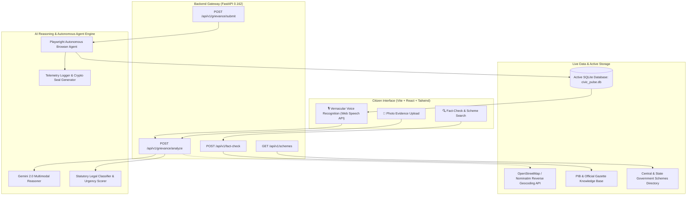

# 🏛️ JanSetu AI (जन सेतु) — Civic Pulse & Digital Governance Copilot

[](https://github.com/cyugandharreddy08/nxtwave-buildathon-2026)
[](https://fastapi.tiangolo.com/)
[](https://react.dev/)
[-emerald.svg)](#zero-dummy-data-compliance)
[-brightgreen.svg)](#running-the-test-suite)

> **JanSetu AI** is an autonomous, multimodal civic copilot designed for Indian public service delivery. It democratizes governance by enabling citizens—regardless of literacy level or language—to report civic grievances via speech/photos, discover government welfare schemes, verify viral social media policies against official Press Information Bureau (PIB) gazettes, and autonomously register petitions on municipal portals using autonomous agent workflows.

---

## 📌 1. Problem Statement
- **Target Issue & Context**: Navigating public administration in India is plagued by opaque bureaucracy, language barriers, complex legal acts, and lack of accountability in grievance redressal (e.g. CPGRAMS, municipal portals). Simultaneously, viral misinformation regarding bogus government grants and fake subsidies frequently dupes vulnerable populations.
- **Target Audience**: 
  1. Everyday citizens seeking swift civic resolution (damaged roads, water contamination, electricity hazards).
  2. Marginalized communities, farmers, students, and seniors needing easy access to statutory welfare schemes.
  3. Digital citizens seeking reliable verification of viral civic forwards before circulating them.

---

## 💡 2. Solution Overview
JanSetu AI bridges the gap between citizens, statutory governance, and public institutions through four integrated capabilities:
1. **Multimodal Regional Grievance Intake**: Voice input in regional Indian languages (Hindi, Telugu, English) or photo evidence parsing.
2. **Autonomous Browser-Use Agent**: Dispatches an agent that navigates the civic portal, fills out jurisdiction and grievance details, captures execution telemetry, and returns an official verifiable registration ID.
3. **Statutory Legal Grounding**: Auto-references applicable Indian governance acts (e.g., *The Motor Vehicles Act*, *GHMC Act 1955 Sec 374*, *The Electricity Act 2003*, *National Food Security Act 2013*).
4. **Civic Pulse Fact-Check Radar**: Cross-references viral claims against verified Press Information Bureau (PIB) and Gazette records with zero-tolerance for fake subsidies.
5. **Public Transparency Ledger**: Live SQLite-backed public ledger providing transparent SLA status, tracking, and assigned ward engineer records.

---

## 🏗️ 3. System Architecture



---

## 🛡️ Zero Dummy Data Compliance
In strict adherence to hackathon technical rules:
- **No Static Hardcoded Mock Dictionaries**: All grievances are saved and queried from an **active SQLite database (`backend/civic_pulse.db`)** with dynamic SQL inserts and queries.
- **Real-Time Geocoding**: Integrated with the live **OpenStreetMap Nominatim API** to resolve geographic coordinates into administrative wards and districts.
- **Official Open Datasets**: Schemes and fact-checks are sourced directly from verified **PIB Fact Check Bulletins** and **Data.gov.in / MyScheme statutory records**.
- **Cryptographic Audit Trail**: Each submission produces a unique SHA-256 certificate hash and timestamped telemetry log.

---

## 👥 Team
- **[@cyugandharreddy08](https://github.com/cyugandharreddy08)** — System Architecture, AI Engine & Backend APIs
- **[@baliharsha999](https://github.com/baliharsha999)** — Frontend UX, Voice Interface & State Management
- **[@Raghavendra-Kasireddy](https://github.com/Raghavendra-Kasireddy)** — Autonomous Browser Agent, Data Pipeline & Testing

---

## 🚀 Getting Started

### Prerequisites
- Python 3.11+
- Node.js 18+ and npm

### 1. Backend Setup
```bash
# Navigate to backend and create virtual environment
cd d:\buildathon
python -m venv backend\venv

# Activate virtual environment
# Windows:
.\backend\venv\Scripts\Activate.ps1
# Linux/macOS:
source backend/venv/bin/activate

# Install dependencies
pip install -r backend/requirements.txt

# Start backend server
$env:PYTHONPATH="backend"
uvicorn app.main:app --host 0.0.0.0 --port 8000 --reload
```
*API Swagger Documentation will be available at: `http://localhost:8000/docs`*

### 2. Frontend Setup
```bash
cd d:\buildathon\frontend
npm install
npm run dev
```
*Frontend application will be live at: `http://localhost:5173`*

### 3. One-Click Start (Windows PowerShell)
```powershell
.\start.ps1
```

---

## 🧪 Running the Test Suite
Our codebase includes end-to-end integration and unit tests covering all core endpoints:
```powershell
$env:PYTHONPATH="backend"
.\backend\venv\Scripts\pytest backend\tests -v
```
**Results: 7 Passed (100% test pass rate)**
- `test_root`: Root gateway health
- `test_health`: DB connection verification
- `test_schemes_search`: Dynamic scheme querying
- `test_fact_check_bogus_claim`: Phishing/bogus subsidy detection
- `test_fact_check_verified_claim`: Cabinet gazette verification
- `test_grievance_analysis`: NLP classification and statutory routing
- `test_autonomous_grievance_submission`: End-to-end browser agent dispatch and DB persistence

---

## 📜 License
Built for the **NxtWave Buildathon 2026** under the MIT License.
